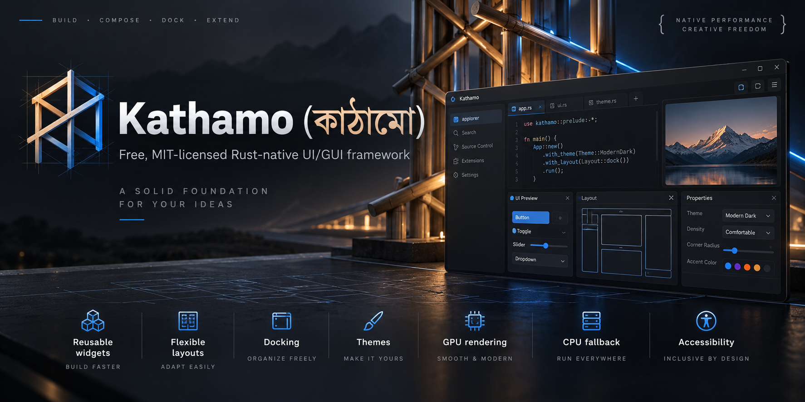
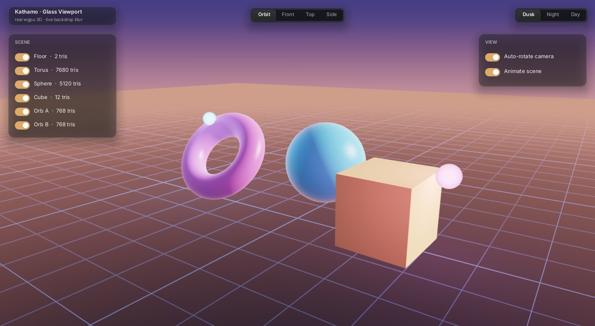

<p align="center">
  
</p>

<h1 align="center">Kathamo (কাঠামো)</h1>

<p align="center"><b>Desktop apps that look like the modern web. Without shipping a browser.</b></p>

---

You know the feeling. You open a beautiful app — soft glass panels, smooth animations, crisp type — and your fan spins up, because under the hood it is a whole web browser eating your memory and your GPU.

Or you pick a lightweight native toolkit, and your app looks like it was made in 2005.

**Kathamo ends that trade-off.** It is a pure Rust UI framework that gives you the look and feel of Linear, Vercel and Raycast, running natively on your GPU, with no browser, no JavaScript, and no Electron.

> In Bengali idol-making, the **কাঠামো (Kathamo)** is the bamboo and wood frame built first. Clay, colour and ornament all rest on it. This framework is that frame for your app.

<p align="center">
  
  <br/><i>A real 3D viewport under live frosted glass. Every panel blurs the moving scene behind it.</i>
</p>

## Why Kathamo

**It looks like the web.** Spring-animated hovers and toggles, frosted-glass menus and toasts, flexbox layout, glowing focus rings, sliding tab pills, crisp text with ellipsis, and syntax-coloured code blocks. The polish people expect today is built in.

**It stays out of your way.** A full GPU app runs in about 175 MB of RAM and uses **0 % CPU when nothing is happening** — measured, not promised. It draws on the integrated GPU by default, so your discrete GPU and its VRAM stay free for games, renders and AI models.

**It is built for creative tools.** Docking panels, node editors, timelines, property inspectors, asset browsers, command palettes and real 3D viewports come ready to use. Kathamo is the frame behind Kalponic Studio's own apps for 2D art, 3D, video, rigging and AI.

**It speaks your language.** Proper text shaping for English and Bengali side by side, from day one.

**It is pure Rust.** One fast binary. No Node, no webview, no runtime to install.

**It works with AI agents.** Any app can save a screenshot of itself without a screen, and an inspector API lets agents find and test every control. Your coding agents can see what they build.

## Who it is for

- **Indie developers** building tools, launchers and editors who want them to feel premium.
- **Game and art studios** making in-house pipelines that must look good and stay light.
- **AI app builders** who need every megabyte of VRAM for the model, not the interface.
- **Anyone tired of choosing** between beautiful and lightweight.

## See it in 60 seconds

```bash
git clone https://github.com/jony100200/Kathamo
cd Kathamo
cargo run --release -p kathamo --example glass_viewport
```

Drag to orbit the scene, scroll to zoom, and watch the glass follow. Then try:

| Demo | What you will see |
| :--- | :--- |
| `cargo run --release -p kathamo --example kathamo_forge` | A game-engine editor: scene tree, inspector, asset browser, console |
| `cargo run --release -p kathamo --example kathamo_chat` | A modern AI chat app with highlighted code blocks |
| `cargo run --release -p kathamo --example visual_designer` | Drag-and-drop UI designer that exports Rust |

## Your first app

```rust
use kathamo::prelude::*;

#[derive(Default)]
struct Hello {
    glow: bool,
}

impl KathamoApp for Hello {
    fn title(&self) -> &str {
        "Hello, Kathamo"
    }

    fn update(&mut self, ctx: &mut AppContext) {
        let area = Rect::from_min_size(Vec2::new(40.0, 40.0), Vec2::new(320.0, 200.0));
        let mut ui = LayoutBuilder::new(area, &mut ctx.cmd_buf, &ctx.pointer, &ctx.theme);
        ui.card(|ui| {
            ui.heading("Hello, Kathamo");
            ui.label("Native Rust. Web-grade looks.");
            ui.toggle("Glow", &mut self.glow);
            if ui.button("Click me") {
                println!("clicked");
            }
        });
    }
}

fn main() {
    run_native(Hello::default()).unwrap();
}
```

That is a real, GPU-rendered native window.

## Honest status

Kathamo is young and moving fast. It is built and tested on **Windows**. It should run on Linux, but that is not yet verified by the maintainer — if you try it, we would love to hear how it goes in an issue.

## Go deeper

- **[Developer Guide](AGENT_GUIDE.md)** — architecture, components, layouts, SDK reference and measured benchmarks.
- **[Acknowledgements](ACKNOWLEDGEMENTS.md)** — the fonts, icons and open-source crates Kathamo stands on.
- **License** — [MIT](LICENSE). Use it, ship it, build something beautiful.

<p align="center"><i>Made with care by Kalponic Studio.</i></p>
